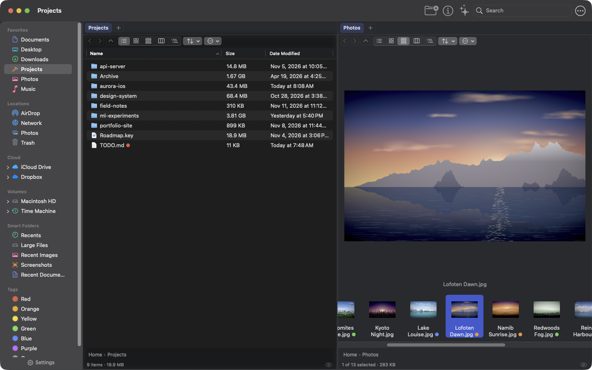
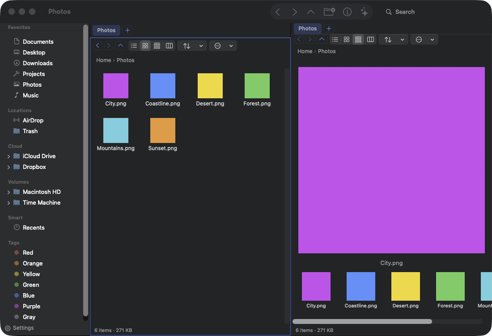

# Pathem

A fast, native macOS file manager. Dual-pane, keyboard-driven, and built to stay
quick even in folders with a lot of files.

It's a Finder alternative for people who want more control, in the spirit of
Directory Opus or Path Finder. Written in Swift and AppKit. No Electron.


**Website:** [pathem.app](https://pathem.app)



<sub>Dual pane, tabs per pane, a customizable sidebar, and colored tags. (Screenshots use a built-in demo workspace, so no real files are shown.)</sub>

## Proven fast: the one-million-row test

"Only the rows on screen are built" is not marketing. Reproduce it in one command:

```
make gate-a
```

It loads **1,000,000** synthetic rows into the real file list and reports how many
cell views the table actually materializes:

```
=== GATE A: view-based NSTableView virtualization ===
built 1000000 FileEntry in 914 ms
reloadData + first layout: 523 ms
numberOfRows = 1000000
cell views requested for initial display = 84
cells materialized per jump: lastRow=93 mid=93 top=84
RESULT: PASS: table materializes bounded cells regardless of 1M-row dataset
```

Jump to row 1,000,000, the middle, or back to the top and the table still builds
**fewer than 100 cell views, not a million**. The check is part of the CI suite, so a
virtualization regression fails the build. (Timings are from a debug build; release
is faster.)

## What it does

- Two panes side by side, with tabs per pane, and copy and move between them
  (F5 and F6). Synchronized browsing keeps the two panes in step: descend into a
  subfolder on one side and the other follows into its own matching subfolder.
- Stays fast in large folders. Only the rows on screen are built, so 100k or even
  a million files scroll without lag.
- Drag and drop: drag files between panes, to and from Finder, or onto the
  sidebar. Copy by default, hold Command to move.
- Full cut, copy, and paste for files and folders (Cmd-C / Cmd-X / Cmd-V), across
  panes and with Finder and other apps. Cut items stay dimmed until you paste
  them, name clashes prompt to skip, replace, or keep both, and every paste is
  undoable.
- A customizable sidebar. Reorder shortcuts by drag, rename them, change their
  icons, and organize them into your own groups. Cloud services and mounted
  volumes show up automatically below your groups.
- An embedded terminal that follows the active folder (Ctrl-`). It runs a real
  login shell (vim, ssh, REPLs, colors) and is themeable: pick System, Dracula,
  Nord, or Solarized, or set your own font, colors, and shell.
- On-device semantic search. Type what you're after in plain language and Pathem
  ranks the folder by meaning, using Apple's NaturalLanguage embeddings over file
  names and the text inside files (including PDFs). It runs entirely on your Mac,
  costs nothing, and doesn't need Apple Intelligence. (OCR for images is built in
  but off by default for now.)
- A command palette and an on-device AI command bar, both bound to a rebindable
  command registry and keymap.
- Per-folder saved views, saved layouts, Quick Look (Space), and batch rename.
- Quick navigation: an editable path bar, back, forward, up, and double-click or
  Return to open a folder. Sortable columns (name, size, date modified), folders
  first.
- Cloud-aware. It browses iCloud, Dropbox, Drive, and OneDrive folders (each shown
  with a small service badge so a "Documents" in iCloud reads apart from one in
  Drive) and never silently downloads online-only files just to list or index them.
- Remote and cloud transfer, built in: connect to S3 (and S3-compatible stores like
  Backblaze B2, Google Cloud Storage, and Wasabi), Azure Blob, WebDAV, SFTP, and
  FTP, and copy to and from them with a progress and cancel sheet. SFTP and FTP are
  covered by opt-in live round-trip tests against real servers; S3, Azure, and WebDAV
  run full CRUD through the built product and system curl against hermetic loopback
  services. The object-storage fixtures cryptographically verify AWS SigV4 and Azure
  Shared Key and reject bad credentials, in addition to the parser unit tests. Saved
  sites carry color labels, groups, per-site path bookmarks, and a paired local folder.
  Every network backend runs out-of-process.
- Git-aware. Files in a repository show status badges (modified, staged,
  untracked), and "Reclaim in Repo" tells regenerable build output (safe to
  clean) from precious untracked data (worth backing up).
- Copy and move never overwrite silently. When a name already exists you choose
  to skip, replace, or keep both, and a same-folder drop can never trash a file
  onto itself.

List, icon, gallery, and column views, set per folder and remembered:



## Make it yours

Nearly every surface is customizable, in the spirit of Directory Opus:

- **Color rules (labels)** color and style filenames by rules: extension, name
  pattern, size, or folder-vs-file, with a color plus bold or italic. The first
  matching rule wins, and it applies across list, icon, column, and tree views.
- **The right-click menu** is a drag-to-reorder editor (uncheck to hide, reset to
  default), and the **toolbar** takes any command, including your own external
  commands.
- **The sidebar** reorders items, user groups, and whole sections by drag.
- **Commander mode** (Total Commander-style F-keys) is rebindable, and the status
  bar shows what you pick (item count, size, free space).
- **Defaults you set once**: the view mode and sort new folders open in, decimal or
  binary file sizes, relative or absolute dates, where new tabs open, and default
  names for New File and New Folder.
- Every command is rebindable and reachable from the command palette, and the UI is
  localized into English, Japanese, German, Spanish, Chinese, and French. The
  non-English translations are provisional, so if one reads wrong in your language,
  a quick note helps: see [docs/TRANSLATIONS.md](docs/TRANSLATIONS.md).

You can also make Pathem the default app for opening folders (fully reversible), and
a Reset Pathem Data command restores Finder and clears Pathem's data for a clean
uninstall.

## Torrents

Tools > Torrents is a built-in BitTorrent client, powered by our own native Swift
engine (no third-party library bundled). Add a `.torrent` file or paste a magnet
link and it downloads: a live list shows name, size, a progress bar, download rate,
peers, and status, pause or resume any torrent, and remove one keeping or deleting
its files. Magnet links fetch their metadata from peers first (ut_metadata), then
download like any torrent. Downloads persist and resume across restarts. All of the
peer and network code runs in a separate `pathem-torrentd` process, so it never runs
inside the Full-Disk-Access app, the same model Pathem uses for its other risky work.
Pathem also seeds: connections are bidirectional, so it serves pieces to peers (an
"Up" column shows the upload rate) and accepts incoming peers. The engine (tracker
client, peer wire protocol, metadata exchange, SHA-1 piece verification, sparse file
storage, seeding, DHT) is unit-tested, including an end-to-end test where a real
leecher downloads a file from a real seeder over TCP and verifies it byte-for-byte.
The product E2E also crosses the real app/daemon boundary for `.torrent` and magnet
adds, file selection, peer/tracker details, limits, pause/resume, removal, and restart
restoration.
Peers come from HTTP trackers, from the mainline DHT (BEP 5) so a trackerless
magnet still finds peers, and from peer exchange (PEX, receive side). To accept
incoming peers behind common home NAT, Pathem asks your router to forward the
port via NAT-PMP, falling back to UPnP-IGD for routers that speak only UPnP.
Message-stream encryption (MSE) is supported; µTP is experimental (off by
default, outbound only, and not yet tested against a third-party client).

## Why it's fast

Two things do most of the work. To read a folder, Pathem uses getattrlistbulk,
which returns many entries and their attributes in one system call instead of a
readdir plus a stat for every file. To draw the list, it uses a view-based
NSTableView with cell reuse, so only the visible rows are ever created.

Rough numbers on an Apple Silicon Mac, loading a synthetic folder of a million
entries:

```
1,000,000 entries
reload + first layout:                  ~47 ms
cell views built for the first screen:  ~93   (about the visible rows x 3 columns)
cell views built per scroll jump:       ~100
```

Jumping to the last row costs about the same as jumping to the tenth.

## Built to be trustworthy

Pathem needs Full Disk Access to be a real file manager, so it treats that access
carefully. Anything that parses untrusted input, talks to the network, or drives
an external tool, the S3/WebDAV/SFTP/FTP backends, archive extraction, and the
iOS-device (AFC) browser, runs **out-of-process** in a short-lived helper, not in
the app that holds your grant. There is no embedded scripting engine and no
in-process third-party code, so the app keeps a **clean Hardened Runtime with no
opt-outs** (no `allow-jit`, no `disable-library-validation`). If code-backed
extensions ever land, they are out-of-process Swift helpers, signed and
crash-isolated, that inherit none of the app's access. Credentials go to tools
over stdin, never on a command line, and remote paths and names are escaped so a
crafted filename can't smuggle a shell or protocol option (there are tests for
each of these).

## Install

Build from source today (below). A prebuilt download is not published yet.

### Download (coming with the first release)

There is no `.dmg` on [Releases](https://github.com/Scarcrux/Pathem/releases)
yet. The first tagged release will be a universal (Apple Silicon + Intel),
Developer ID-signed, notarized, stapled build you can drag to Applications with
no Gatekeeper warnings and no build step, and it will update itself via Sparkle
(App menu > Check for Updates…). The release pipeline that produces it
(`.github/workflows/release.yml`, triggered on a `v*` tag) is in place; the
signing keys and notarization credentials are the remaining setup. Until then,
build from source.

### Build from source

Building it yourself needs no Apple Developer account: a locally compiled app is
not quarantined, so it launches with no Gatekeeper prompts. You need macOS 15 or
later and the Swift toolchain (Xcode, or just the Command Line Tools via
`xcode-select --install`).

```
git clone https://github.com/Scarcrux/Pathem.git
cd Pathem
make install     # build a host-architecture Pathem.app and put it in /Applications
# or
make run         # build and launch straight from source
```

Signing and notarization only matter if you hand someone a prebuilt download;
they are not needed to build and run it yourself.

## Building

```
make run            # build and launch from source (fastest loop)
make build          # build the engine and the app
make test           # run the engine tests
make smoke          # launch and assert the window/pane layout invariants
make ui-test        # drive 35 core + 11 conditional real-iCloud interaction checks
make e2e            # run every hermetic product-level scenario (including magnets)
make e2e-app        # assemble/sign a release app and probe it externally
make ci             # run localization, build, tests, debug E2E, and release package E2E
make app            # assemble .build/Pathem.app (host arch, ad-hoc signed)
make install        # build the app and copy it to /Applications
make watch          # rebuild and relaunch on every save (fast debug loop)
make watch-install  # same, but reinstall the signed app each save
make dev-cert       # create a stable self-signed identity so a Full Disk Access
                    # grant survives rebuilds (then SIGN_IDENTITY=... make install)
```

(The Make targets select Xcode's Swift toolchain and SwiftPM's native build system; this avoids a
standalone-toolchain/Xcode SDK mismatch and an Xcode 27 `swiftbuild` Metal regression.) `make
watch` is the quickest way to iterate:
edit a file, save, and Pathem rebuilds and relaunches itself.

See [the test coverage matrix](docs/TEST_MATRIX.md) for what each layer proves, what CI runs, and
which hardware or public-network checks remain opt-in.

### Packaging a .app

`make app` (or `scripts/package.sh`) assembles an ad-hoc signed `Pathem.app`
under `.build/`. Local builds default to your Mac's architecture (fast);
distribution builds (`DEVELOPER_ID` set) go universal. The script builds each
architecture separately and joins them with `lipo`, which sidesteps the Metal
toolchain that a single multi-arch SwiftPM build would otherwise require for
SwiftTerm's shader. `make install` also copies the app to /Applications.

```
make app                                 # local, host arch, ad-hoc signed
ARCHS="arm64 x86_64" scripts/package.sh  # universal, no Metal toolchain needed
```

For a distributable build, set `DEVELOPER_ID` to a "Developer ID Application"
identity (signs with Hardened Runtime) and `NOTARY_PROFILE` to a stored
`notarytool` profile to also notarize and staple. See the comments at the top of
the script.

### Releasing (and auto-update)

`.github/workflows/release.yml` builds, signs, notarizes, generates a signed
Sparkle appcast, and attaches everything to a GitHub Release on a `v*` tag. It
needs repo secrets (documented at the top of that file): the Developer ID
certificate and notary credentials, plus `SPARKLE_PRIVATE_KEY`.

One-time Sparkle setup: run Sparkle's `generate_keys` to create an EdDSA key
pair, paste the public key into `Packaging/Info.plist` as `SUPublicEDKey`, and
store the exported private key (`generate_keys -x private.key`) as the
`SPARKLE_PRIVATE_KEY` secret. Until `SUPublicEDKey` is set, the updater stays
dormant (source and unsigned builds simply say updates aren't configured).

This bundle is the prerequisite for the App Intents and Services surfaces. Full
Shortcuts discovery of the semantic-search action also needs the App Intents
metadata-extraction step, which the Xcode build system runs but a plain `swift
build` does not yet; the intent code and the bundle are in place. The command
bar's on-device LLM additionally needs macOS 26 with Apple Intelligence and
falls back to a heuristic everywhere else.

## Full Disk Access

Pathem is non-sandboxed, so your home folder works out of the box. To browse
everything (other users, system folders, some app data), grant it Full Disk
Access: **System Settings ▸ Privacy & Security ▸ Full Disk Access**, then add
Pathem. The app shows a one-time prompt with a shortcut to that pane on first
launch. Without it, an unreadable folder is shown as "Pathem may need Full Disk
Access" rather than a blank pane.

## Status

Useful day to day: a fast dual-pane file manager with tabs per pane, a fully
customizable sidebar, toolbar, and context menu, drag and drop (files land in
Finder, other apps, and browser upload zones), an embedded themeable terminal,
per-folder saved views, saved layouts, Quick Look, batch rename, a command
palette, on-device semantic search, git-status badges, a cleanup view and an
active file organizer, and a watcher that keeps the view in sync with the disk.
Remote and cloud transfer (S3, Azure Blob, WebDAV, SFTP, FTP) runs out-of-process and is
built in. Auto-update ships via Sparkle. DESIGN.md and ROADMAP.md have the full
plan.

## License

MIT, see [LICENSE](LICENSE). "Pathem" is the project name, so please don't ship a
fork under it.

Built by [Scarcrux](https://github.com/Scarcrux). If Pathem is useful to you, a
star helps, and you can find my other work on
[my profile](https://github.com/Scarcrux?tab=repositories).
